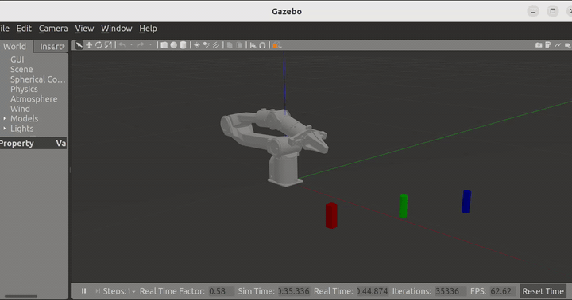

# Piper Robot Arm — Gazebo Pick-and-Place 仿真

基于 ROS 2 Humble + Gazebo + MoveIt2 的 Piper 六轴机械臂自动抓取码放（Pick-and-Place）仿真项目。

<p align="center">
  
  <br>
  <em>Piper 机械臂自动抓取绿色圆柱 → 红色方块 → 蓝色圆柱</em>
</p>

---

## 目录结构

```
src/
├── piper_description/          # 机器人模型描述包
├── piper_gazebo/               # Gazebo 仿真 + 抓取逻辑包
└── piper_moveit/               # MoveIt2 运动规划配置包
```

---

## 各包文件清单

### 1. piper_description — 机器人 URDF 模型

| 文件 | 说明 |
|------|------|
| `urdf/piper_description.urdf` | 纯 URDF 格式的机器人模型描述，可直接加载到 Robot Visualization |
| `urdf/piper_description.xacro` | xacro 格式（带 transmission 和 gazebo_ros2_control 插件），**不含 GazeboSystem 硬件接口** |
| `urdf/piper_description_gazebo.xacro` | xacro 格式（带 **GazeboSystem** ros2_control 硬件插件，含 position 命令/状态接口），此文件用于 Gazebo 仿真 |
| `meshes/*.STL` | 各 Link 的 3D 碰撞/显示网格文件（base_link, link1~link8, gripper_base） |
| `CMakeLists.txt` / `package.xml` | 编译和依赖声明 |

> **注意**：`piper_description_gazebo.xacro` 包含 `<ros2_control>` 块，使用 `gazebo_ros2_control/GazeboSystem` 硬件插件；而 `piper_description.xacro` 使用 `transmission_interface/SimpleTransmission` + `gazebo_ros2_control` 传统方式。两个文件均可用于 Gazebo，但 GazeboSystem 方式是 ROS2 Humble 的推荐方式。

### 2. piper_gazebo — 仿真环境与抓取逻辑

| 文件 | 说明 |
|------|------|
| `src/pick_and_place.cpp` | **核心抓取程序**。通过 MoveIt2 MoveGroupInterface 实现完整 8 步骤抓取码放流程 |
| `src/link_attacher_plugin.cpp` | **Gazebo WorldPlugin**。提供 `/piper/attach` / `/piper/detach` 两个 Service，在 Gazebo 物理引擎中创建/销毁固定关节实现物体吸附 |
| `srv/AttachDetach.srv` | 自定义 Service 接口：请求含 robot_model/link, object_model/link；响应含 success 和 message |
| `launch/piper_with_gripper/piper_gazebo.launch.py` | **基础版**：仅启动 Gazebo + robot_state_publisher + 控制器，无 MoveIt |
| `launch/piper_with_gripper/piper_gazebo_moveit.launch.py` | **调试版**：Gazebo + MoveIt2 + RViz，用于手动规划调试，无自动抓取 |
| `launch/piper_with_gripper/piper_pick_and_place.launch.py` | **完整版**：Gazebo（带物体 world）+ MoveIt2 + RViz + 自动抓取节点 |
| `worlds/piper_pick.world` | Gazebo 世界文件：包含地面、光照、三个抓取物体（红色方块、绿色圆柱、蓝色圆柱）、LinkAttacherPlugin 配置 |
| `config/ros2_controllers.yaml` | ros2_control 控制器参数：arm_controller(JointTrajectoryController, 6 关节) + gripper_controller(JointTrajectoryController, 2 关节) + joint_state_broadcaster，update_rate=500Hz |
| `CMakeLists.txt` | 构建配置：编译 piper_link_attacher 共享库 + pick_and_place 可执行文件 + AttachDetach 服务接口 |

### 3. piper_moveit — MoveIt2 运动规划配置

| 文件 | 说明 |
|------|------|
| `config/piper.srdf` | **语义机器人描述**。定义 `arm` 规划组（chain: base_link→link6）和 `gripper` 规划组（joint7, joint8），禁用相邻 Link 间的碰撞检测 |
| `config/kinematics.yaml` | 运动学求解器：KDL，搜索精度 0.005，超时 5ms |
| `config/joint_limits.yaml` | 关节速度限位，默认速度缩放 0.1 |
| `config/ros2_controllers.yaml` | ros2_control 配置（同 piper_gazebo），但 update_rate=100Hz |
| `config/moveit_controllers.yaml` | MoveIt 控制器映射：arm_controller → FollowJointTrajectory (joint1~6), gripper_controller → FollowJointTrajectory (joint7~8) |
| `config/initial_positions.yaml` | 初始关节位置（全零） |
| `config/pilz_cartesian_limits.yaml` | Pilz 笛卡尔规划器限位 |
| `config/sensors_3d.yaml` | 3D 传感器配置（预留，未使用） |
| `config/piper.urdf.xacro` | 集成 xacro：引入 piper_description_gazebo.xacro + mock_components 虚拟硬件（用于纯 MoveIt 演示无 Gazebo） |
| `config/piper.ros2_control.xacro` | ros2_control xacro 宏，使用 mock_components/GenericSystem 虚拟硬件接口 |
| `launch/demo.launch.py` | **MoveIt 纯演示**：启动 move_group + RViz，无仿真/硬件，通过 moveit_configs_utils 模板生成 |
| `launch/move_group.launch.py` | 仅启动 move_group 节点，无 RViz |
| `launch/moveit_rviz.launch.py` | 仅启动 RViz + MoveIt 插件 |
| `launch/rsp.launch.py` | 仅启动 robot_state_publisher |
| `launch/spawn_controllers.launch.py` | 通过 controller_manager/spawner 加载 arm_controller + gripper_controller + joint_state_broadcaster |
| `launch/static_virtual_joint_tfs.launch.py` | 发布 world→base_link 静态 TF（非 Gazebo 环境使用） |
| `launch/warehouse_db.launch.py` | 启动 MongoDB 规划场景数据库（可选） |
| `launch/setup_assistant.launch.py` | 启动 MoveIt Setup Assistant GUI 配置工具 |

---

## 依赖安装

### ROS2 基础

```bash
# 已安装 ROS2 Humble 的前提下
sudo apt install ros-humble-ros-base
```

### 必须依赖

```bash
# —— MoveIt2 ——
sudo apt install ros-humble-moveit \
                 ros-humble-moveit-ros-planning-interface \
                 ros-humble-moveit-configs-utils \
                 ros-humble-moveit-simple-controller-manager \
                 ros-humble-moveit-kinematics \
                 ros-humble-moveit-planners \
                 ros-humble-moveit-ros-move-group \
                 ros-humble-moveit-ros-visualization \
                 ros-humble-moveit-ros-warehouse \
                 ros-humble-moveit-setup-assistant \
                 ros-humble-warehouse-ros-mongo

# —— Gazebo ——
sudo apt install ros-humble-gazebo-ros \
                 ros-humble-gazebo-ros2-control \
                 ros-humble-gazebo-dev \
                 ros-humble-gazebo-msgs

# —— 控制器 ——
sudo apt install ros-humble-controller-manager \
                 ros-humble-joint-state-broadcaster \
                 ros-humble-joint-state-publisher \
                 ros-humble-joint-trajectory-controller \
                 ros-humble-ros2-control

# —— 工具 ——
sudo apt install ros-humble-xacro \
                 ros-humble-robot-state-publisher \
                 ros-humble-tf2-ros \
                 ros-humble-rviz2 \
                 ros-humble-rosidl-default-generators
```

### 编译

```bash
cd <workspace>
colcon build --packages-select piper_description piper_gazebo piper_moveit
source install/setup.bash
```

---

## 抓取仿真运行指令

### 一键运行（推荐）

```bash
ros2 launch piper_gazebo piper_pick_and_place.launch.py
```

启动后自动执行：
1. Gazebo 加载 `piper_pick.world`（含三个物体和 LinkAttacherPlugin）
2. 生成机器人模型，加载控制器
3. 启动 MoveIt2 move_group（运动规划核心）
4. 启动 RViz2 + MoveIt 插件（可视化）
5. **自动运行 `pick_and_place` 节点**，依次抓取：
   - **绿色圆柱** (green_cylinder) — 从 (0.45, 0.02) 搬运到 (0.300, -0.350)
   - **红色方块** (red_box) — 从 (0.36, -0.16) 搬运到 (0.300, -0.350)
   - **蓝色圆柱** (blue_sphere) — 从 (0.55, 0.17) 搬运到 (0.300, -0.350)

### 其他启动方式

| 指令 | 用途 |
|------|------|
| `ros2 launch piper_gazebo piper_gazebo_moveit.launch.py` | 启动 Gazebo + MoveIt + RViz，**不自动抓取**，手动在 RViz 中规划 |
| `ros2 launch piper_gazebo piper_gazebo.launch.py` | 仅启动 Gazebo + 机器人 + 控制器，无 MoveIt 无 RViz |
| `ros2 launch piper_moveit demo.launch.py` | 仅启动 MoveIt 纯演示（无 Gazebo），在 RViz 中手动规划 |
| `ros2 launch piper_moveit move_group.launch.py` | 仅启动 move_group（无 RViz 无 Gazebo） |

### 抓取流程（8 步骤）

```
  approach（顶部接近）
    → descent（直线下降至抓取高度）
      → attach（吸附物体到末端）
        → lift（抬升）
          → transfer（水平移动到码放位上方）
            → release（下降释放）
              → open gripper + detach（张开夹爪 + 分离物体）
                → retract（抬升收回）
```

每个步骤优先使用 `computeCartesianPath()` **笛卡尔直线规划**（确保直线运动避碰），失败时自动 **降级到关节空间规划**。

---

## 系统架构与数据流

```
┌──────────────────────────────────────────────────────────────┐
│  ros2 launch piper_pick_and_place.launch.py                  │
├──────────────────────────────────────────────────────────────┤
│                                                              │
│  ┌──────────────────────────────────────────────────┐        │
│  │ piper_pick.world                                 │        │
│  │  ├─ red_box      (0.36, -0.16, 0.03)            │        │
│  │  ├─ green_cylinder (0.45, 0.02, 0.03)           │        │
│  │  ├─ blue_sphere  (0.55, 0.17, 0.03)            │        │
│  │  └─ LinkAttacherPlugin → /piper/attach + detach │        │
│  └───────────┬──────────────────────────────────────┘        │
│              │ spawn_entity                                   │
│              ▼                                                │
│  ┌──────────────────┐    ┌────────────────────────┐          │
│  │  robot_state_     │    │  ros2_control          │          │
│  │  publisher        │    │  ├─ joint_state_       │          │
│  │  (TF + /robot_    │    │  │   broadcaster       │          │
│  │   description)    │    │  ├─ arm_controller     │          │
│  │                   │    │  └─ gripper_controller │          │
│  └────────┬──────────┘    └────────┬───────────────┘          │
│           │                        │                          │
│           ▼                        ▼                          │
│  ┌──────────────────────────────────────────────┐             │
│  │  Gazebo 物理引擎 (GazeboSystem)                │             │
│  │  ← 位置命令 / → 关节状态 + TF                  │             │
│  └──────────────────────────────────────────────┘             │
│                                                               │
│  ┌──────────────────────────────────────────────┐             │
│  │  MoveIt2 move_group                          │             │
│  │  ├─ 规划流水线 (OMPL/Pilz)                   │             │
│  │  ├─ KDL 运动学求解器                          │             │
│  │  └─ /move_action Action Server                │             │
│  └──────────┬───────────────────────────────────┘             │
│             │ /move_action (规划 + 执行请求)                    │
│             ▼                                                  │
│  ┌──────────────────────────────────────────────┐             │
│  │  pick_and_place 节点                          │             │
│  │  ┌────────────────────────────────────────┐  │             │
│  │  │ 1. waitForRuntimeDependencies()        │  │             │
│  │  │ 2. configureMoveGroup()                │  │             │
│  │  │ 3. 回到 home 姿态                       │  │             │
│  │  │ 4. 遍历每个物体：                        │  │             │
│  │  │    a. updateObject() ← /get_entity_state│  │             │
│  │  │    b. makeObjectPoses() → 6 步位姿序列   │  │             │
│  │  │    c. moveLinear() → computeCartesianPath│  │             │
│  │  │    d. attachObject() → /piper/attach     │  │             │
│  │  │    e. moveLinear() → lift → transfer     │  │             │
│  │  │    f. detachObject() → /piper/detach     │  │             │
│  │  │ 5. 回到零位                              │  │             │
│  │  └────────────────────────────────────────┘  │             │
│  └──────────────────────────────────────────────┘             │
│                                                               │
│  ┌──────────────────────────────────────────────┐             │
│  │  RViz2 + MoveIt MotionPlanning 面板          │             │
│  │  （可视化规划场景和运动轨迹）                    │             │
│  └──────────────────────────────────────────────┘             │
└──────────────────────────────────────────────────────────────┘
```

---

## 关键参数

这些参数可通过 launch 文件或 YAML 动态调整：

| 参数 | 默认值 | 说明 |
|------|--------|------|
| `approach_clearance` | 0.18 m | 接近时高于物体的安全间隙 |
| `lift_z` | 0.24 m | 抓取后抬升的 Z 高度 |
| `grasp_z_offset` | -0.010 m | 抓取时 Z 偏移（相对物体底部） |
| `min_grasp_z` | 0.045 m | 最低抓取高度 |
| `release_z` | 0.150 m | 释放高度 |
| `tool_z_offset` | 0.13 m | TCP 相对于 link6 的 Z 偏移 |
| `max_place_attempts` | 3 | 最大尝试轮数 |
| `attach_robot_link` | "link6" | 物体吸附到的末端 Link |

---

## 退出状态码

| 返回码 | 含义 |
|--------|------|
| 0 | 全部物体成功抓取码放 |
| 1 | 部分物体抓取失败 |
| 2 | 运行时依赖缺失（Gazebo/控制器/插件未就绪） |
| 3 | 无法回到 home 姿态（MoveIt 控制器连接问题） |

---

## 常见问题排查

**Q: Gazebo 启动后看不到物体？**
> 确认 `GAZEBO_PLUGIN_PATH` 包含 `piper_gazebo` 的 lib 路径。使用 `piper_pick_and_place.launch.py` 会自动设置。

**Q: `/piper/attach` 服务未找到？**
> 确认 `piper_pick.world` 中包含了 `<plugin name="piper_link_attacher" filename="libpiper_link_attacher.so"/>`，且编译后 `.so` 文件在 `GAZEBO_PLUGIN_PATH` 中。

**Q: MoveIt 规划失败 / 控制器无法连接？**
> `pick_and_place` 内部有自动重试机制（home 最多 5 次，每个物体最多 3 轮），主要原因是 arm_controller 的 ActionServer 启动较慢，首次规划请求可能超时。

**Q: 笛卡尔规划覆盖率不足？**
> 程序会自动降级到关节空间规划（`setPoseTarget`），但路径不再是直线，可能与物体发生碰撞。调整 `approach_clearance` 和 `lift_z` 参数可改善笛卡尔规划成功率。
