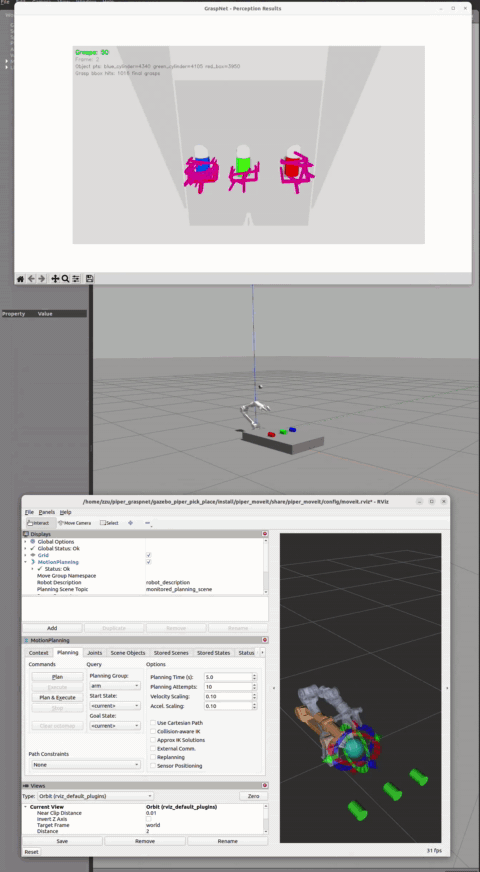

# Piper 机械臂 GraspNet 视觉抓取系统 —— 从零搭建完整教程

> 从空环境开始，一步步搭建一个"看一眼就能抓起三个物体并放好"的完整仿真系统：
> Gazebo 仿真 → MoveIt 运动规划 → GraspNet 视觉推理 → 机械臂拾取放置。
> 文中所有"实战问题"均来自真实开发记录，附完整排查过程。



---

## 第 0 章 写在前面

### 0.1 这套系统能做什么

一个 Gazebo 仿真场景中有三个物体（绿色圆柱、蓝色球体、红色圆柱），顶部相机每秒拍摄 15 帧画面。系统的工作流程是：

1. 相机画面实时桥接到 Docker 容器中的 GraspNet 神经网络
2. GraspNet 推理出每个物体的抓取位置**和姿态**（6D 抓取位姿）
3. 主控节点从上百个候选抓取中筛选"既能抓到、又能放下"的方案
4. 机械臂执行完整的拾取-放置动作，依次抓完三个物体（约 100 秒）

这不是"点个位置随便抓"的玩具：**抓取姿态是神经网络预测的真值**，经过坐标映射、运动学验证、门控检查后才执行。

### 0.2 学习路径

```
第 1 章  环境搭建（ROS2/Gazebo/MoveIt/Docker）
  ↓
第 2 章  Gazebo 仿真基础（URDF 差异 / ros2_control / 控制器）
  ↓
第 3 章  MoveIt 配置（Setup Assistant 生成 + 4 项必改修复）
  ↓
第 4 章  抓取机制（自定义 Service + Gazebo 插件实现 attach/detach）
  ↓
第 5 章  视觉感知（相机建模 / 点云预处理 / 颜色分割）
  ↓
第 6 章  GraspNet 集成（Docker 推理 / 坐标变换 / 6D 姿态映射）
  ↓
第 7 章  抓取决策（候选遍历 / 四段预检 / 门控 / 状态闭环）
  ↓
第 8 章  调试与诊断（时好时坏根因 / IK 求解器三实验）
  ↓
第 9 章  常见问题 FAQ
```

每章结构统一：**目标 → 具体步骤 → 验证方法 → 实战问题（现象 → 排查 → 定位 → 解决）**。

### 0.3 需要什么基础

- 熟悉 Linux 命令行（终端操作、环境变量）
- 了解机器人运动学基本概念（关节、末端执行器、逆运动学）
- 不需要 ROS 经验（第 1-3 章会从零讲起）
- 不需要深度学习经验（GraspNet 是现成模型，只需会跑推理）

### 0.4 技术栈一览

| 组件 | 作用 |
|---|---|
| Ubuntu 22.04 + ROS 2 Humble | 系统与通信框架 |
| Gazebo Classic 11 | 物理仿真（刚体、碰撞、相机） |
| MoveIt2 | 运动规划（OMPL、IK、碰撞检测） |
| GraspNet（Docker） | 6D 抓取姿态推理 |
| ssik | 解析逆解求解器（机械臂专用） |
| Open3D | 推理端离屏渲染 |

---

## 第 1 章 环境搭建

### 1.1 安装检查

```bash
source /opt/ros/humble/setup.bash
echo $ROS_DISTRO          # 应输出 humble

gazebo --version          # Gazebo multi-robot simulator, version 11.x
ros2 pkg list | grep moveit   # 应列出 moveit 相关包
```

### 1.2 必须安装的依赖

```bash
# MoveIt2 全家桶
sudo apt install ros-humble-moveit \
                 ros-humble-moveit-ros-planning-interface \
                 ros-humble-moveit-configs-utils \
                 ros-humble-moveit-simple-controller-manager \
                 ros-humble-moveit-kinematics \
                 ros-humble-moveit-planners \
                 ros-humble-moveit-ros-move-group \
                 ros-humble-moveit-ros-visualization \
                 ros-humble-moveit-setup-assistant

# Gazebo + ros2_control + 控制器
sudo apt install ros-humble-gazebo-ros ros-humble-gazebo-ros2-control \
                 ros-humble-gazebo-dev ros-humble-gazebo-msgs \
                 ros-humble-joint-state-broadcaster \
                 ros-humble-joint-trajectory-controller \
                 ros-humble-control-msgs ros-humble-gazebo-plugins

# 工具
sudo apt install python3-pip clang-format-15 ffmpeg
```

### 1.3 编译与验证

```bash
cd <workspace>
source /opt/ros/humble/setup.bash
colcon build --packages-select piper_gazebo
source install/setup.bash
```

> ⚠️ **编译坑（真实遇到）**：如果机器装过 Homebrew（`/home/linuxbrew`），它的 binutils 会劫持系统 `ld`，导致链接报大量 `undefined reference`（如 `libcurl.so: undefined reference to ssh_pki_export_pubkey_base64`）。排查方式：`which ld` 若指向 `/home/linuxbrew/...` 就是它。
> ```bash
> export PATH=$(echo "$PATH" | tr ':' '\n' | grep -v "linuxbrew" | paste -sd:)
> # 验证：which ld 应显示 /usr/bin/ld
> ```

### 1.4 实战问题 1：Docker 镜像构建慢到超时（GraspNet 推理环境）

**现象**：`graspnet-baseline` 镜像首次构建卡在 PyTorch 下载，`download.pytorch.org` 读取超时，1.6GB 的 `torch==1.11.0+cu113` wheel 反复下载失败；即便偶有进展，改一行源码也会触发重装。

**排查过程**：

1. 先分析 Dockerfile 找瓶颈——仓库本身只有 31MB，耗时全在 apt/pip 下载、PyTorch 安装、CUDA 扩展编译
2. 发现两个结构问题：
   - 安装 torch 时**没有指定 wheel 源**，默认源慢且易失败
   - `COPY . .` 放在扩展编译**之前**，任何源码变动都会让依赖层缓存失效、触发重装
3. 第一次改进：分层（apt 一层 / pip 一层 / 编译一层）+ `pip` 超时调到 1000s + 拆出 `.dockerignore`——apt 层缓存生效，但 torch 大 wheel 依然下载超时
4. 用户提出灵魂拷问："为什么不使用国内源，换个版本不行吗？"——受此启发换思路

**定位与解决**：**不用 pip 下载 torch，改用预装 PyTorch 的 NGC 基础镜像** `nvcr.io/nvidia/pytorch:22.03-py3`（内置 Python 3.8 + PyTorch 1.12 + CUDA 11.6 + cuDNN）。这样：

- torch 下载成本转移到基础镜像层（一次拉取，永久复用）
- Dockerfile 删掉 torch/torchvision 的 pip 层
- 剩余依赖（Open3D 0.17 约 420MB、opencv 74MB 等）走**清华 pip 源**，速度正常
- 最终镜像 `graspnet-baseline:20.04` 构建成功，后续改代码只重建最后 COPY 层（秒级）

**教训**：大依赖（PyTorch 级）优先选"预装它的基础镜像"而不是"pip 现场下载"；国内网络环境下 pip 务必配国内源（清华/阿里）。

### 1.5 实战问题 2：demo 推理"慢"的误判（Xvfb 假死）

**现象**：headless 模式跑 demo，等了很久没输出，怀疑是模型推理慢。

**排查**：`nvidia-smi` 显示 **GPU 上没有 Python 计算进程**——模型根本没在跑；进容器 `ps` 发现只剩 `xvfb-run` 和 `Xvfb`，python 进程已退出但包装进程没退出，输出被吞掉。

**解决**：放弃 Xvfb 实时渲染路径，改为**离线输出模式**（推理后把场景点云 PCD、抓取器网格 PLY、原始预测 NPY 写回主机挂载目录），主机端用 Open3D 查看。耗时从"无限等待"变成约 3 秒。

**教训**：headless 渲染包装（Xvfb）是常见假死点；先查 GPU 占用确认"是否真在算"，再怀疑慢不慢。

---

## 第 2 章 Gazebo 仿真基础

### 2.1 一个 URDF，两个版本

新手最容易困惑：为什么同一个机械臂有多个 URDF 文件？

| 对比维度 | RViz 版 | Gazebo 版 |
|---|---|---|
| 硬件接口 | 不需要 ros2_control | **必须**含 ros2_control 段 |
| 物理属性 | 只要视觉+碰撞 | **还要惯性参数**（质量/惯量） |
| 控制器 | 无 | 需要指定硬件插件类型 |
| 用途 | 纯显示/TF 树 | 物理引擎驱动 |

```
RViz 显示：URDF → robot_state_publisher → TF 树 → RViz 渲染
            （不需要物理引擎，只要网格和关节关系）

Gazebo 仿真：URDF → robot_state_publisher → Gazebo 生成刚体 → 物理引擎驱动
            （必须有惯性参数 + ros2_control 硬件接口 + 控制器）
```

### 2.2 给 URDF 加 ros2_control 段

机械臂 URDF 通常从 SolidWorks（sw_urdf_exporter 插件）导出，自带 Link/Joint、STL 网格、惯性参数——但**缺 ros2_control 硬件接口段和 Gazebo 插件**，需要手动补：

```xml
<!-- 1. 硬件接口段（在 </robot> 之前） -->
<ros2_control name="GazeboSystem" type="system">
  <hardware>
    <plugin>gazebo_ros2_control/GazeboSystem</plugin>
  </hardware>
  <joint name="joint1">
    <command_interface name="position"/>
    <state_interface name="position"/>
    <state_interface name="velocity"/>
  </joint>
  <!-- joint2 ~ joint8 同理 -->
</ros2_control>

<!-- 2. Gazebo 插件激活 -->
<gazebo>
  <plugin name="gazebo_ros2_control" filename="libgazebo_ros2_control.so">
    <parameters>$(find piper_gazebo)/config/ros2_controllers.yaml</parameters>
  </plugin>
</gazebo>
```

> ⚠️ **command_interfaces 组合限制（真实报错）**：`joint_trajectory_controller` 对接口组合有严格限制，`[position, velocity, effort]` 三者共存会报：
> ```
> Invalid value set during initialization for parameter
> 'command_interfaces': 'effort' command interface has to be used alone
> ```
> 位置控制机械臂最安全写法：`command_interfaces: [position]`。

### 2.3 控制器参数文件

```yaml
controller_manager:
  ros__parameters:
    update_rate: 500          # Gazebo 更新频率
    arm_controller:
      type: joint_trajectory_controller/JointTrajectoryController
    gripper_controller:
      type: joint_trajectory_controller/JointTrajectoryController
    joint_state_broadcaster:
      type: joint_state_broadcaster/JointStateBroadcaster

arm_controller:
  ros__parameters:
    joints: [joint1, joint2, joint3, joint4, joint5, joint6]
    command_interfaces: [position]
    state_interfaces: [position, velocity]

gripper_controller:
  ros__parameters:
    joints: [joint7, joint8]
    command_interfaces: [position]
    state_interfaces: [position, velocity]
```

**验证**：`ros2 control list_controllers` 应看到三个控制器 active；`ros2 topic echo /joint_states` 有数据。

---

## 第 3 章 MoveIt 配置

### 3.1 用 Setup Assistant 生成配置包

```bash
ros2 run moveit_setup_assistant moveit_setup_assistant
```

关键操作步骤（跟着点即可）：

1. **加载 URDF**：选 **Gazebo 版**（带 ros2_control 段的那个）——选纯 URDF 会导致检测不到控制接口
2. **Self-Collision Matrix**：Generate Collision Matrix → 接受默认
3. **Virtual Joints**：`fixed_base_joint`，child=`base_link`，parent=`world`，type=fixed
4. **Planning Groups**：
   - `arm` 组：Kinematic Solver=KDLKinematicsPlugin，Type=Chain，base_link→link6
   - `gripper` 组：Solver=**None**，Type=Joint，joint7+joint8
5. **End Effector**：`grasp_frame`，group=gripper，parent=link6
6. **Controller**：arm_controller（joint1-6）+ gripper_controller（joint7-8），type=FollowJointTrajectory
7. **Generate Package**：包名 `piper_moveit`

生成的结构：

```
piper_moveit/
├── config/
│   ├── piper.srdf                 # 语义描述（规划组、碰撞对）
│   ├── kinematics.yaml            # IK 求解器配置
│   ├── joint_limits.yaml          # 关节限位
│   ├── moveit_controllers.yaml    # 控制器映射（给 MoveIt 看）
│   └── ros2_controllers.yaml      # 控制器定义（给 controller_manager 看）
├── launch/                        # demo / move_group / rsp / rviz 等
└── .setup_assistant
```

### 3.2 实战问题 3：生成后 4 项必改修复（不修必炸）

Setup Assistant 生成的配置**并非开箱即用**，以下 4 处必须手动调整：

**修复 1：joint_limits.yaml 整数类型**

**现象**：启动 move_group 报参数类型错误。

**报错**：
```
parameter 'robot_description_planning.joint_limits.joint1.max_velocity'
has invalid type: expected [double] got [integer]
```

**原因**：生成器输出整数 `max_velocity: 5`，MoveIt2 要求 double（已知 bug，[moveit2#2776](https://github.com/ros-planning/moveit2/issues/2776)）。

**解决**：全部改为浮点：`max_velocity: 5.0`、`max_acceleration: 0.0`。

**修复 2：kinematics.yaml 删掉 gripper 的 KDL 条目**

**现象**：move_group 启动报 IK 实例化失败。

**报错**：
```
Group 'gripper' is not a chain. Kinematics solver could not be
instantiated for group 'gripper'.
```

**原因**：KDL 只支持链式结构；gripper 是两个独立关节（不是链），不需要 IK 求解器。

**解决**：`kinematics.yaml` 中保留 arm 条目，**整个删除 gripper 条目**。

**修复 3：moveit_controllers.yaml 补 action_ns**

**现象**：MoveIt 找不到控制器。

**报错**：
```
No action namespace specified for controller 'arm_controller'
```

**原因**：MoveIt 通过 Action 接口通信，`FollowJointTrajectory` 的 Action 路径是 `/arm_controller/follow_joint_trajectory`，不指定 `action_ns` 就找不到。

**解决**：
```yaml
arm_controller:
  type: FollowJointTrajectory
  action_ns: follow_joint_trajectory    # 必须加
  joints: [joint1, ...]
```

**修复 4：use_sim_time 时间同步**

**现象**：运动执行被突然中止。

**报错**：
```
time diff: 1784522272.329s → Execute request aborted
```

**原因**：Gazebo 用仿真时间，MoveIt/RViz 默认系统时间，差了几十年。

**解决**：launch 里每个节点的 parameters 都加 `{"use_sim_time": True}`（move_group、rviz 都必须）。

### 3.3 验证

```bash
ros2 launch piper_moveit demo.launch.py   # RViz 里拖动目标位姿，看能否规划
```

能规划出一条无碰撞轨迹，说明 MoveIt 配置完成。

---

## 第 4 章 抓取机制（MoveIt 控制 Gazebo + 自定义吸附插件）

### 4.1 先理解控制数据流

MoveIt 规划出来的轨迹怎么变成 Gazebo 里机械臂的运动？完整链路：

```
用户设置目标位姿
  → MoveIt move_group 规划（OMPL，读 /robot_description + /joint_states）
  → 轨迹发往 /arm_controller/follow_joint_trajectory（Action）
  → controller_manager 转发给 JointTrajectoryController
  → 控制器 500Hz 插值 → 写入 ros2_control 硬件接口
  → GazeboSystem 插件 → Gazebo 物理引擎执行
  → 关节状态经 joint_state_broadcaster → /joint_states
  → robot_state_publisher → /tf → MoveIt/RViz 闭环
```

关键映射在 `moveit_controllers.yaml`：MoveIt 内部控制器名 → Action 路径 → 物理控制器。

### 4.2 为什么"抓取"需要自定义 Service + Gazebo 插件

**问题**：机械臂移到物体位置后，怎么让物体"粘"在夹爪上？

**不好的方案**：夹爪闭合夹住物体——Gazebo 摩擦模型不够精确，物体容易滑落/弹飞。

**好的方案**：在物理引擎里创建**固定关节（Fixed Joint）**，把物体 Link 刚性绑到夹爪 Link 上。这需要：

1. **自定义 Service 接口**（`srv/AttachDetach.srv`）——ROS 2 没有"吸附物体"的现成服务：

```
string robot_model      # 例如 "piper"
string robot_link       # 例如 "link6"
string object_model     # 例如 "green_cylinder"
string object_link      # 物体上的连接点，本项目统一为 "link"
---
bool success
string message
```

2. **Gazebo WorldPlugin**（`link_attacher_plugin.cpp`）——普通 ROS 节点不能直接调 Gazebo C++ API（`physics::Joint`），必须在 Gazebo 进程内运行插件：

```
LinkAttacherPlugin (WorldPlugin)
├── Load()：创建 ROS 节点，注册 /piper/attach 和 /piper/detach 两个 Service
├── handleAttach()：physics->CreateJoint("fixed") → Attach(robot_link, object_link)
├── handleDetach()：查找并销毁固定关节
└── std::mutex 保护 attached_joints_ 字典
```

**为什么必须是 WorldPlugin 而不是 ModelPlugin**：attach 要同时访问机器人模型和物体模型两个模型，只有 WorldPlugin 在世界加载时能访问全部模型。

world 文件中加载插件：

```xml
<plugin name="piper_link_attacher" filename="libpiper_link_attacher.so"/>
```

### 4.3 环境变量坑（必须设置）

插件 `.so` 在 `install/lib/piper_gazebo/` 下，launch 里不设 `GAZEBO_PLUGIN_PATH` 的话，**插件静默失败，Service 注册不上**——表现为"调 attach 服务找不到服务"：

```python
SetEnvironmentVariable("GAZEBO_PLUGIN_PATH",
    f"{plugin_lib}:{os.environ.get('GAZEBO_PLUGIN_PATH', '')}")
SetEnvironmentVariable("LD_LIBRARY_PATH",
    f"{typesupport_lib}:{os.environ.get('LD_LIBRARY_PATH', '')}")
```

### 4.4 抓取-释放完整时序

```
pick_and_place 节点                      LinkAttacherPlugin
  │ 1. 机械臂下降到物体位置（张开夹爪）        │
  │ 2. 距离门控验证（TCP 与物体 < 8cm）      │
  │ 3. /piper/attach {robot_link: link6,   │
  │    object_model: green_cylinder} ────>  │ 4. 创建固定关节 link6→物体
  │ 5. success=true <────────────────────  │
  │ 6. 开爪垂直升高（物体随臂运动）            │
  │ 7. 移动到放置点                           │
  │ 8. /piper/detach ───────────────────>  │ 9. 销毁固定关节
  │ 10. 物体留在放置点，机械臂收回             │
```

### 4.5 实战问题 4：attach 服务迟迟不执行

**现象**：夹爪到达目标点后，`/piper/attach` 迟迟不触发，抓取流程卡住。

**排查过程**（真实开发记录）：

1. 先确认插件是否真的注册了服务：`ros2 service list | grep attach`——若没有，是 `GAZEBO_PLUGIN_PATH` 没设对（见 4.3）
2. 服务在，但调用不执行——检查 attach 前置条件：代码里有**距离门控**（TCP 与物体中心距离超过阈值就拒绝 attach），物体被之前的操作碰移了位置，实际距离超限
3. 关键修正：**每次抓取前实时读物体位姿**（`/gazebo/get_entity_state`），不依赖固定坐标；attach 前再做一次门控验证
4. 另一个反复出现的现象：attach 执行**时机**不对——最终把流程定为"到达目标点过程中一直保持夹爪张开，到位后 attach，垂直升高 10cm 再转移、放置后 detach"

**教训**：attach 卡住优先查三件事——服务是否注册（插件路径）、门控是否通过（实时位姿）、时机是否正确（先到位再 attach）。

### 4.6 实战问题 5：夹爪朝向错误（末端朝天）

**现象**：机械臂末端位姿没有朝向物体，反而朝向上面，抓不到物体。

**排查**：相机给出的"夹爪位姿"只有位置被使用，姿态没有正确传递——GraspNet 预测的抓取方向与机械臂 TCP 的"夹爪前向"定义不一致，直接套用导致 TCP 指向随机方向。

**解决**：建立**完整的姿态映射**（见第 6 章 calib_18）——GraspNet 抓取坐标系的 X/Y/Z 轴需要逐一映射到夹爪的"接近方向/宽度方向/轴向"，映射错了就是 90°~180° 的朝向偏差。最终以"夹爪必须朝向物体、与物体接触或误差 <1cm"作为验收标准反复校准。

---

## 第 5 章 视觉感知（相机 + 点云 + 颜色分割）

### 5.1 相机建模

Gazebo world 里加一个 RGB-D 深度相机：

```xml
<sensor name="camera" type="depth">
  <camera>
    <horizontal_fov>1.0</horizontal_fov>   <!-- 约 57° HFOV -->
    <image><width>800</width><height>600</height></image>
  </camera>
  <update_rate>15.0</update_rate>
  <plugin name="overhead_camera_plugin" filename="libgazebo_ros_camera.so"/>
</sensor>
```

**关键演进**（真实踩坑史）：相机最初垂直向下拍，三个物体 + 机械臂互相遮挡，点云残缺；后来改为斜向俯视（pitch 60°）覆盖物体簇，并配合平面过滤；最终按物体布局固定相机位姿。

**ROS 2 Humble 话题坑**：`gazebo_ros_camera` 的 `cameraName`/`imageTopicName` 参数**无效**，话题路径固定为 `/<sensor_name>/<default_topic>`——所以 sensor 名直接叫 `camera`，话题就是 `/camera/image_raw`、`/camera/depth/image_raw`。

### 5.2 桥接节点：ROS → 共享目录

相机 15Hz 发话题，但 GraspNet 推理只有 ~0.5Hz，且推理在 Docker 容器里（不能直接订阅 ROS 话题）。解法：桥接节点把最新帧**原子写入共享目录**：

```
camera_bridge_node.py
├── 订阅 /camera/image_raw, depth, camera_info
├── 深度 米→毫米、uint16 存 PNG
├── 颜色直接存 BGR（不要做 RGB 转换！见实战问题 6）
├── 写 meta.mat（内参 + factor_depth=1000）
└── 最后写 .ready 标志（Docker 端以此为"新帧就绪"信号）
```

### 5.3 Docker 端点云生成与预处理

```
读 color.png + depth.png + meta.mat
  → 生成点云（内参反投影）
  → RANSAC 平面过滤（移除桌面平台）
  → 颜色阈值分割（红/绿/蓝掩膜）→ 每个物体的点云
  → GraspNet 推理（每物体生成抓取候选）
```

### 5.4 实战问题 6：BGR/RGB 通道错乱（红蓝互换）

**现象**：红色物体被识别成蓝色、蓝色被识别成红色；绿色正常（R≈0、B≈0 对称，不受影响）。

**排查**：桥接节点写了 `cvtColor(BGR2RGB)` 再 `imwrite`，Docker 端 `imread` 后又做了一次 `cvtColor(BGR2RGB)`——**双重交换 = 通道回原样错位**。而外参恰好有一个符号错误，让"错位的标签"在世界坐标里碰巧匹配了正确先验，所以红色能抓、蓝色始终失败——**两个 bug 互相掩盖**，极其隐蔽。

**解决**：桥接节点**直接保存 BGR**（`cv2.imwrite` 本来就要 BGR），删除多余转换；同时修正外参符号（见下）。

**教训**：图像通道只在数据流的一个边界转换一次；两处转换=必错。当"部分颜色失败"时，先怀疑通道。

### 5.5 实战问题 7：相机外参符号错误（34cm 偏差）

**现象**：偏离画面中心的物体（红/蓝）抓取位置误差 32-34cm。

**排查**：`CAMERA_TO_WORLD_R[1][0] = +1.0` 符号错误——camera_x 方向映射到 world_y 方向相反，越偏离画面中心误差越大。

**解决**（关键设计）：
- **位置变换**用 `kCameraToWorldPositionR`（R[1][0]=-1.0，几何正确）
- **姿态旋转**用 `kCameraToWorldRotationR`（R[1][0]=+1.0，保持 IK 可达的映射方向）
- 平移 T_y 从 0.022 微调到 -0.001 消除系统偏差

位置和姿态的旋转矩阵**分开配置**——这是调试中得到的实用技巧：几何正确的映射未必运动学友好，两者解耦后各自独立校准。最终把 34cm 偏差压到 <6cm。

### 5.6 实战问题 8：平面过滤吃掉圆柱

**现象**：点云显示时"圆柱轮廓消失"。

**排查**：桌面平台（灰色）与物体颜色相近的区域被 RANSAC 平面模型误吞——平面过滤的阈值/迭代参数把物体底部点云一并当成了平面。

**解决**：调整平面过滤参数（距离阈值），并确认平台材质颜色在分割掩膜之外（中性灰不属于红/绿/蓝掩膜）。**验证方式**：把过滤后的点云在 Open3D 里逐帧显示，肉眼确认三个物体完整。

---

## 第 6 章 GraspNet 集成（Docker 推理 + 6D 姿态映射）

### 6.1 推理流水线

GraspNet 在 Docker 容器内运行 `inference_from_camera.py`，工作循环：

```
等待 .ready 标志出现（新帧就绪）
  → 读 color/depth/meta
  → 生成点云 → 平面过滤 → 颜色分割
  → 每物体点云 → GraspNet 前传（300 view）
  → 碰撞过滤（collision_thresh=0.01）
  → 生成抓取候选（GraspGroup：位置+姿态+宽度+分数）
  → 写入 perception_grasps.csv + result.png（Open3D 离屏渲染）
  → 删除 .ready → 等下一帧
```

### 6.2 坐标变换链（本项目最核心的部分）

GraspNet 输出的抓取位姿在**相机坐标系**，机械臂要执行必须转换到**机械臂坐标系**：

```
GraspNet 抓取位姿（camera 系）
  → 外参 R/T：camera → world（见实战问题 7）
  → calib_18 映射：GraspNet 抓取坐标系 → 夹爪 TCP 坐标系
      R = [[0,-1,0],
           [0, 0,-1],
           [1, 0, 0]]
  → TCP 偏移：link6 → grasp_tcp 沿 Z 0.14m（kTcpOffsetFromLink6Z）
  → 得到机械臂可执行的完整 6D 目标位姿
```

**calib_18 是什么**：GraspNet 的抓取坐标系定义（X=接近方向、Y=宽度方向、Z=轴向）与夹爪的 TCP 定义不同，需要矩阵映射。开发早期枚举了 **24 种映射变体**（6 种轴置换 × 8 种符号组合）逐个测试——最终收敛到 calib_18 这一个正确映射。

### 6.3 实战问题 9：只用了位置、没用姿态

**现象（真实用户拷问）**："你使用 GraspNet，却只是用它的识别位置而不采用姿态，那为什么还要用这个算法？别的算法也能定位啊——不就是因为它能识别抓取姿态才选它的吗？"

**排查**：早期实现确实只取了抓取位置、姿态随意给——原因是姿态映射没做（见 6.2），直接套用会朝向错误（实战问题 5）。调研开源 GraspNet 案例后发现：**姿态必须经过坐标系映射才能用**，这是普遍问题而非本项目独有。

**解决**：完整实现 calib_18 映射 + 姿态门控，让 GraspNet 的 6D 姿态成为真正的执行真值。

### 6.4 实战问题 10：夹爪旋转 127.7°

**现象**：抓取时夹爪姿态与预期相差 127.7°，抓不到。

**排查**：候选姿态枚举的 `calib_5` 变体**轴映射错误**——X 轴被映射到 -X，导致 TCP 前向取到了 GraspNet 的 Y 轴（宽度方向当接近方向）。

**解决**：**只保留 calib_18 单选**，删除其余 23 个变体（含辅助的 calib_15）——消除了"枚举变体间互相干扰"的隐患，127.7° 消失。

**教训**：姿态映射变体一旦确认正确，务必单选收敛；保留多套枚举会让错误变体在特定位姿下"复活"。

### 6.5 Docker 镜像管理

**当前镜像与依赖链**（`graspnet-baseline:20.04` 是唯一被脚本引用的镜像）：

| 镜像 | 大小 | 角色 |
|---|---|---|
| `graspnet-baseline:20.04` | 25.5GB | **使用中**（`graspnet-docker-camera.sh` / `run_inference.sh` 引用） |
| `nvcr.io/nvidia/pytorch:22.03-py3` | 22.2GB | Dockerfile `FROM` 基础（预装 PyTorch 1.12 + CUDA 11.6） |

> **2026-08-02 修正**：cuda:11.4.0-devel/base 曾记录为 "pytorch 的父层（共享层，不可单独删）"，
> 经 `RootFS.Layers` 层交集验证与 pytorch **零共享层**（pytorch ↔ graspnet 共享 46/47 层，
> 但 cuda 11.4 两镜像与两者交集均为 0），实为早期废弃构建路径（PLAN.md 中的 `FROM nvidia/cuda:11.4.0-devel`）
> 的孤儿镜像，已于 2026-08-02 删除，释放 ~9.4GB。

**识别孤儿镜像**（历史遗留，可安全删除）：

```bash
# 1. 无任何脚本引用（grep 项目脚本里的镜像名）
# 2. 无容器使用（docker ps -a 为空）
# 3. 与在用镜像不共享层（docker system df -v 看 SHARED SIZE）
# 实例：graspnet-baseline:latest（7/25 基于 ubuntu 直建的旧版）已删除
# 实例：nvcr.io/nvidia/cuda:11.4.0-base/devel（废弃构建路径残留，8/2 层验证后删除）
```

**清理与验证**：

```bash
docker rmi <孤儿镜像>          # 删孤儿
docker image prune -f          # 清悬空中间镜像（释放 ~18GB）
docker run --rm graspnet-baseline:20.04 \
  python3 -c "import torch, graspnetAPI"   # 验证在用镜像完好
```

> 删除镜像不影响挂载的宿主目录（`shared_camera_data/` 与推理脚本均为 volume 挂载），清理后流水线直接可用。

---

## 第 7 章 抓取决策（候选遍历 / 四段预检 / 门控 / 状态闭环）

### 7.1 从"一堆候选"到"一个可执行方案"

GraspNet 对每个物体输出**最多 300 个抓取候选**（位置+姿态+分数），主节点要做的是：找到第一个"既能抓、又能放"的候选。这就是 `chooseReachableGraspCandidate` 的工作：

```
候选排序（视觉中心距离升序 → 分数降序）
  → round-robin 姿态桶重排（8 个桶，按四元数符号分，保证交替尝试不同抓取方向）
  → 逐个候选做 4 段 AND 预检：
     ① approach 预检：目标上方安全位姿能否规划
     ② grasp 预检：抓取位姿能否规划
     ③ lift 预检：抓取位姿抬高 7cm 能否规划
     ④ place 预检：放置位姿能否规划
  → 四段全部通过 → 选中该候选；否则尝试下一个
```

**为什么是 4 段 AND**：防止"抓得到、放不下"——如果只验证抓取段，执行到 transfer 才发现放置位不可达，物体已经挂在夹爪上，失败代价极大。四段全过才执行，换来的是执行期高成功率（代价是预检耗时，见第 8 章问题 13）。

### 7.2 门控体系（执行前的最后防线）

即使候选通过预检，执行 attach 前还有实时门控：

| 门控 | 阈值 | 说明 |
|---|---|---|
| 距离门控 | TCP 与物体中心 ≤ 8cm（`max_grasp_distance`） | 物体被碰移后实时校验 |
| 接近角检查 | >15° 仅 WARN（不阻止） | 抓取方向与预期偏差过大时告警 |

> **门控演进史（真实调试）**：距离门控从 0.1 → 0.6 → 0.06 → 最终 0.08m 收敛；接近角门控最初严格 45°（失败即拒绝），导致大量本可抓取的姿态被拒，**回退为 WARN-only**——门控的目的是防止"强行抓取"，不是追求姿态完美。

### 7.3 解析 IK：候选可达性的裁决者

预检每段都要回答"这个位姿机械臂够不够得着"。项目用 **ssik 解析逆解**（`piper_analytic_ik.cpp` 封装）：

```
目标 grasp_tcp 位姿
  → 减 TCP 偏移（0.14m）得到 link6 位姿
  → 调 Python 脚本 piper_ssik_ik.py（ssik.prebuilt.agilex.piper_ik）
  → 返回候选关节解（按距当前关节角的距离排序）
  → MoveIt 以关节解为目标规划无碰撞轨迹
```

**解析解 vs 数值解**（本项目实测结论）：

| | 解析解（ssik） | 数值解（KDL/DLS） |
|---|---|---|
| 确定性 | 种子无关，`0 解`=真不可达 | 依赖种子，可能假阴性 |
| 速度 | 微秒级 | 毫秒~秒级 |
| 伪解风险 | 低 | 高（180° 镜像伪解，见 8.4） |

### 7.4 状态驱动感知闭环（pick_state）

三个物体依次抓，抓完的物体还会被 GraspNet 识别到（误检/重复推理）。解法：**C++ 主节点 ↔ Docker 推理端的状态同步**：

```
pick_state.json = {"seq": 3, "pending": ["red_box"], "placed": ["green_cylinder","blue_sphere"]}
  ↑ 原子写（tmp+rename）                      
pick_and_place 节点每抓完一个物体更新  ←┐
                                       │ 读
Docker 推理端每帧读 pick_state ────────┘
  → 只对 pending 物体生成候选/写 CSV
  → 已放置物体从感知中消失（掩膜/质心/CSV 全过滤）
```

好处：推理专注剩余物体（候选更准）、放置物体不会被重复抓取、逐物体刷新"新鲜"推理结果。

### 7.5 per-object home 位姿

每个物体抓取前，机械臂先回到该物体专属的"预备位姿"（让规划起始点靠近目标，路径更顺、远离限位）：

| 物体 | joint1 | 其余关节 |
|---|---|---|
| green_cylinder（居中） | 0 | {0.55, -0.75, 0, 0.55, 0} |
| red_box（左侧 y=-0.12） | -0.35 | 同上 |
| blue_sphere（右侧 y=0.17） | +0.35 | 同上 |

放置朝向也绑定启动 home：`back_place_orientation` 是启动 home 位姿处实时读取的 TCP 朝向。

### 7.6 实战问题 11：重构后必须回退（clang-format 的教训）

**现象**：一次"代码风格重构"（删除死代码 + clang-format 统一格式）后，用户要求全部回退。

**教训**：
- 重构前**必须提交/备份**——回退时死代码全恢复了，但 clang-format 的排版无法逐字节还原（无备份无 git）
- clang-format 的 `SortIncludes` 会破坏编译：`urdfdom_headers` 被排到 `moveit` 之后导致头文件依赖顺序错误——需要注释隔离块

**建议**：这类项目从第一天就用 git 管理，每次实验前 commit。

---

## 第 8 章 调试与诊断（时好时坏 / IK 三实验 / 空洞）

### 8.1 现象：系统"时好时坏"

同一套代码，有时三个物体全抓成功，有时只能抓 2 个（红色圆柱失败）。连续记录 6 次运行：

| 运行 | red_box 感知中心 y | 候选结果 | 结局 |
|---|---|---|---|
| 7/31 三次 | -0.121 ~ -0.123 | 0/122、0/249、0/300 全灭 | 2/3 |
| 8/1 三次 | -0.126 ~ -0.134 | 第 112/300 候选成功 | **3/3** |

**差异只有约 1cm**——感知中心的位置波动，翻转为"有解"与"无解"的二进制结果。

### 8.2 根因链

```
感知/物理方差（源头）：
  随机抓取顺序 → 机械臂路径碰撞推移物体 → Gazebo 物理
  + GraspNet 逐帧预测变化
  + 外参残差 ~3cm（感知中心 vs 真实位姿）
      ↓ 1cm 级波动
决策层放大：
  4 段 AND 预检（一段不过=候选作废）
  × 解析 IK 解域空洞（某些姿态×位置组合无解）
  × 失败即终止整个循环（"Stopping pick loop"）
      ↓
  3/3 与 2/3 的随机切换
```

**关键事实**：距离门控（0.08m）在全部 6 次运行中**零拒绝**——门控不是瓶颈；100% 的失败都表现为同一行日志：

```
Piper analytic IK planning failed for red_box visual-center approach: solutions=0
```

### 8.3 IK 求解器三实验（确定"不可达"是真是假）

怀疑 `solutions=0` 是求解器假阴性，做了三个递进实验：

**实验 1：ssik 种子敏感性**——同一位姿换 7 个差异巨大的种子，解集**完全一致**。
→ 结论：ssik 是解析确定性求解器，种子只影响"选哪个解"，不影响"有没有解"。多种子方案无效。

**实验 2：手写 DLS 数值 IK 交叉验证**——对 ssik 报 0 解的位姿，DLS 报"可达"。
→ 但用 MoveIt 权威 FK（`/compute_fk`）验证：**位置误差 0.15mm、姿态误差 179.9°**——是 180° 镜像伪解！旋转误差度量在 180° 处梯度消失，数值 IK 假收敛。
→ 教训：**得出"不可达"结论前，必须用权威 FK 验证求解器输出**。

**实验 3：MoveIt 内置 KDL 实测**——启动 move_group，`/compute_ik` 服务（KDL 数值 IK，50 尝试）对同一批位姿求解：成功位姿全部可解，**空洞位姿 NO_IK_SOLUTION（-31），与 ssik 完全一致**。

**最终结论**："朝下姿态 × 左区(y≈-0.13~-0.15)"是**关节限位约束下的真不可达区**（双求解器确认）——任何 IK 求解器都救不了，只能改任务几何（姿态松弛/物体位置）。

### 8.4 解析空洞 vs 奇异点

| | 奇异点 | 解析空洞（不可达区） |
|---|---|---|
| 本质 | 雅可比降秩（病态但可达） | 无满足限位的 IK 解（真不可达） |
| 空间形状 | 低维流形（曲线/面） | **体区域**（体积） |
| 有解吗 | 有（解退化） | 没有（所有求解器一致） |
| 修复 | 路径绕行/可操作度评分 | 姿态微调绕开/位置调整 |

一句话：**奇异点是你"到了但动不了"的地方，空洞是你"根本到不了"的地方**。

### 8.5 日志分析方法

- 日志位置：`~/.ros/log/pick_and_place_<pid>_<ts>.log`
- 关键行速查：
  - `visual candidate X/Y`：候选遍历进度（相邻两行间隔=该候选预检耗时）
  - `Piper analytic IK planning failed ... solutions=0`：候选不可达（空洞信号）
  - `contact gate PASS`：距离门控通过
  - `Stopping pick loop`：全灭终止（问题点）
  - `Placed 2/3`：最终结果
- **耗时分解法**：抓一个物体 = 感知等待 + 候选预检 + 执行 8 步；逐段打时间戳对比，找出"等在哪里"

### 8.6 实战问题 12：蓝色物体"等好久才抓"（候选预检 37 秒）

**现象**：最后一个物体（蓝色）从开始处理到真正抓取耗时 69 秒，感觉卡住。

**耗时分解**：感知等待 6s + **候选预检 37s** + 执行 20s。

**为什么预检 37s**：
1. 蓝色是最后一个物体，GraspNet 只对它生成候选——**视觉中心门控全部通过**（没有杂物候选），每个候选都进真 IK 预检
2. 大量候选 "approach/grasp PASS 但 lift/place 失败"——每个失败候选白耗 2-6s（各段规划超时）
3. 根因：物体处于远场/解域边缘（IK cost 5-10 远高于正常的 1.6），4 段预检通过率骤降 → 遍历深度暴涨

**结论**：预检耗时的本质是"4 段 AND 严格性 × 解域余量"——候选多不慢，**不可达的候选多才慢**。

---

## 第 9 章 常见问题 FAQ

| # | 问题 | 原因 | 解决 |
|---|---|---|---|
| 1 | 改了 world 文件不生效，圆柱还是横躺 | world 有 **4 份副本**（src + 3 个 install，含 COLCON_IGNORE 旧产物），launch 优先从 install 加载 | 全部副本同步（或统一 source 标准 install） |
| 2 | Gazebo 端口被占用起不来 | 残留 gzserver 进程 | `kill $(pgrep -f gzserver)` |
| 3 | 编译报 `undefined reference to libssh` | Homebrew binutils 劫持 ld | 编译前过滤 linuxbrew PATH（1.3 节） |
| 4 | attach 服务找不到 | GAZEBO_PLUGIN_PATH 未设置，插件静默失败 | launch 里设置插件路径（4.3 节） |
| 5 | 红色识别成蓝色 | BGR/RGB 双重转换 | 桥接只存 BGR，删除多余 cvtColor（5.4 节） |
| 6 | 位置偏差 30cm+ | 相机外参符号错误 | 位置/姿态旋转矩阵分开校准（5.5 节） |
| 7 | 物体点云轮廓消失 | 平面过滤误吞 | 调 RANSAC 阈值 + 掩膜外背景色（5.6 节） |
| 8 | 夹爪朝向不对 | 姿态映射未做/映射错误 | calib_18 单选（6.2/6.4 节） |
| 9 | 抓取卡在 attach | 距离门控超限（物体被碰移） | 抓取前实时读物体位姿（4.5 节） |
| 10 | 执行被中止 | use_sim_time 未设置，时间差几十年 | launch 每个节点加 use_sim_time（3.2 节） |
| 11 | 时好时坏（偶发 2/3） | 感知方差 × 4 段预检放大 × abort | 诊断见第 8 章；修复方向：失败跳过/姿态松弛 |
| 12 | 某个物体"等很久"才抓 | 候选遍历预检慢（不可达候选多） | 日志耗时分解（8.6 节） |
| 13 | Gazebo 卡在"Getting models from models.gazebosim.org" | world 引用了在线模型库且网络受限 | 用本地缓存模型路径（GAZEBO_MODEL_PATH） |
| 14 | webm 视频截取后空白 | vp8 流帧率标记异常，`-ss` 后置 seek 取不到帧 | `-ss` 前置 + 重编码（ffmpeg） |
| 15 | 视频转 GIF 画质差 | 默认 palette 优化不足 | 两遍 palette 法（palettegen + paletteuse） |
| 16 | Docker 磁盘占用大、有历史孤儿镜像 | 早期构建的 `latest` 无引用 | 镜像清单/孤儿识别/清理见 6.5 节 |

---

## 第 10 章 附录

### 10.1 启动命令速查

```bash
# 编译
cd <workspace>/gazebo_piper_pick_place
source /opt/ros/humble/setup.bash
export PATH=$(echo "$PATH" | tr ':' '\n' | grep -v "linuxbrew" | paste -sd:)
colcon build --packages-select piper_gazebo
source install/setup.bash

# 启动完整流水线（终端 1）
ros2 launch piper_gazebo piper_pick_and_place.launch.py

# GraspNet 推理（终端 2，Docker）
cd ~/piper_graspnet && ./graspnet-docker-camera.sh gui

# 结果可视化（终端 3）
cd ~/piper_graspnet && python3 result_viewer.py

# 诊断工具
ros2 service list | grep -E "attach|entity"   # 插件/状态服务
ros2 topic hz /camera/image_raw               # 相机帧率
```

### 10.2 关键参数表

| 参数 | 值 | 含义 |
|---|---|---|
| `back_place_x/y` | 0.40 / -0.20 | 放置点 |
| `min_grasp_z` | 0.12 | 抓取高度下限 |
| `open_gripper_lift_height` | 0.07 | 抓取后抬高 |
| `max_grasp_distance` | 0.08 | 距离门控 |
| `graspnet_6d_max_candidates` | 300 | 候选遍历上限 |
| `randomize_pick_order` | true | 随机抓取顺序 |
| `kCandidatePlanningTime` | 5.0（段超时 1.0） | 预检规划预算 |
| `kTcpOffsetFromLink6Z` | 0.14 | TCP 偏移 |

### 10.3 文件结构

```
gazebo_piper_pick_place/src/
├── piper_description/urdf/      # 机械臂 URDF（SolidWorks 导出 + ros2_control）
├── piper_gazebo/
│   ├── worlds/                  # 两个 world（物体+相机 / 物体+相机+机械臂）
│   ├── src/pick_and_place.cpp   # 主流程（候选/预检/执行/状态更新）
│   ├── src/graspnet_6d_grasp_planner.cpp  # 候选选择
│   ├── src/grasp_frame_transform.cpp      # 坐标映射（calib_18）
│   ├── src/piper_analytic_ik.cpp          # 解析 IK 封装
│   ├── src/link_attacher_plugin.cpp       # attach/detach 插件
│   └── launch/                  # 启动文件（含 4 副本同步提醒）
├── piper_moveit/config/         # MoveIt 配置（SRDF/kinematics/limits）
└── piper_perception/            # 相机桥接（纯 Python）
```

### 10.4 结语

这套系统的价值不在"三个物体抓取"本身，而在它走过的坑：坐标系映射、通道顺序、外参标定、解析解域、状态同步——每一个都是机器人感知抓取项目的通用命题。希望本文能让你少走几轮"2/3 玄学"的弯路。

全文完。

